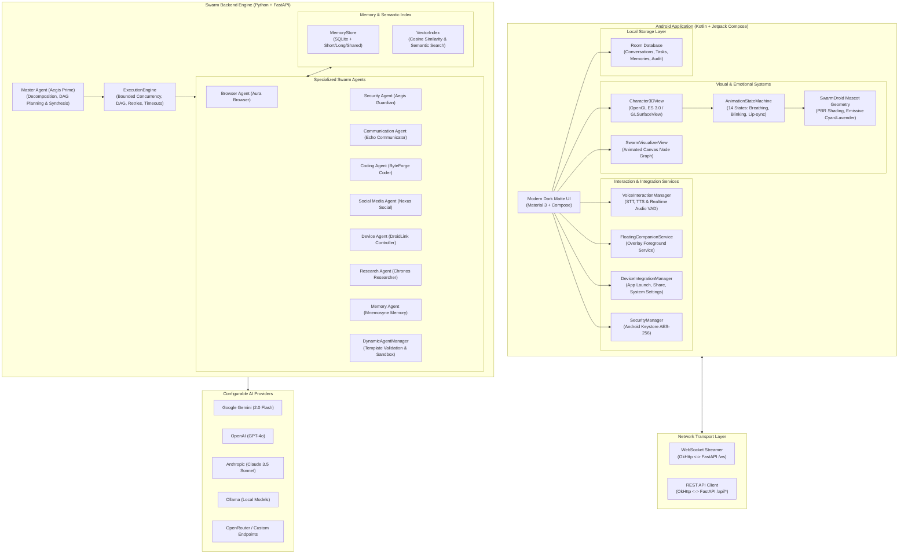

# SwarmDroid — System Architecture

> **"One companion. An entire swarm of intelligence."**

SwarmDroid is an advanced multi-agent AI ecosystem for Android centered around an adorable, fully animated 3D companion robot that visually and emotionally communicates the active intelligence of a collaborative swarm of specialized AI agents.

---

## 1. Architectural Philosophy

Traditional AI assistants present either a static chat box or a simple text-in, text-out interface that hides whether anything is happening behind a single spinning loader. 

SwarmDroid changes this paradigm:
1. **Visual Empathy & Transparency:** The user interacts with an adorable 3D mascot that breathes, blinks, talks, reacts emotionally, and directly reflects what the background agents are doing.
2. **True Swarm Collaboration:** Complex goals are solved by specialized agents collaborating in a Directed Acyclic Graph (DAG) task engine.
3. **Dynamic Capability Spawning:** When a capability is absent, the swarm dynamically instantiates a new sandboxed agent template.
4. **Android Native Precision:** Real device capabilities (TTS, STT, app launching, intent sharing, notifications, camera/document picking) operating under strict human-in-the-loop approvals.
5. **Security by Design:** Android Keystore hardware-backed encryption, prompt injection shields, tool allowlisting, and secret redaction.

---

## 2. System Architecture Diagram

---

## 3. Character 3D & Animation Engine

### 3.1 Mascot Geometry and Design
The companion mascot is an original cute humanoid robot:
- **Head:** Smooth spherical white ceramic finish (`#F0F4F8`).
- **Visor:** Dark curved glossy glass (`#0D0F14`) with real-time specular highlights.
- **Eyes:** Dual expressive glowing electric cyan LED eyes (`#00F5D4`) capable of blinking, pupil dilation, smiling slits, and scan animations.
- **Torso:** Compact chassis with metallic lavender plating (`#B892FF`) and a central glowing swarm reactor orb.
- **Antennas:** Levitating ear pods with synchronized twitch and audio-reactive tilt.
- **Thruster:** Levitating anti-gravity torus ring with spinning cyan particle trails.

### 3.2 14 Animation States
1. `IDLE`: Gentle breathing sine wave, levitation bobbing, natural periodic eye blinks.
2. `HAPPY`: Bouncing excitement, smiling curved eye slits, ear twitch.
3. `THINKING`: Inquisitive head tilt, eyes scanning left to right, pulsing cyan antenna orb.
4. `LISTENING`: Forward attentive posture, audio-reactive soundwave response.
5. `SPEAKING`: Visor mouth waveform modulation synchronized with speech amplitude.
6. `WORKING`: Focused forward lean, multi-agent status halo, orbiting particle ring.
7. `WALKING`: Procedural walk cycle with rhythmic foot/thruster tilts.
8. `RUNNING`: Dynamic forward lean, speed lines, animated thruster flare.
9. `WAVING`: Right hand raised greeting cycle, friendly nod.
10. `CELEBRATING`: Triumphant jump/spin, double hand raise, celebratory glow flare.
11. `SLEEPING`: Low float altitude, closed eye slits, slow rhythmic breathing.
12. `ERROR`: Puzzled head scratch, amber eye flicker, tilted question posture.
13. `SURPRISED`: Sudden jump-back, dilated wide eyes `(o.o)`, expanding aura.
14. `SAD`: Drooped ears, downward gaze, dim slow-pulsing glow.

---

## 4. Multi-Agent Orchestration & Task DAG

When a user submits a prompt:
1. **Prompt Defense:** `SecurityAgent` scans for prompt injection and jailbreak attempts.
2. **Decomposition:** `MasterAgent` evaluates the intent and generates a `TaskDAG` with subtasks, assigned roles, and dependencies.
3. **Capability Gap Check:** If a required role is absent (e.g. `DocumentationAgent`), `DynamicAgentManager` creates a validated, scoped agent instance.
4. **Asynchronous Execution:** `ExecutionEngine` executes ready tasks in parallel within bounded concurrency limits.
5. **Human Approval:** If an agent attempts a sensitive action (e.g. `send_email`, `post_social_media`), execution halts into `WAITING_FOR_APPROVAL` until the user confirms.
6. **Synthesis:** `MasterAgent` reviews the results, produces the response, and sets the companion's 3D emotion to `CELEBRATING`.
