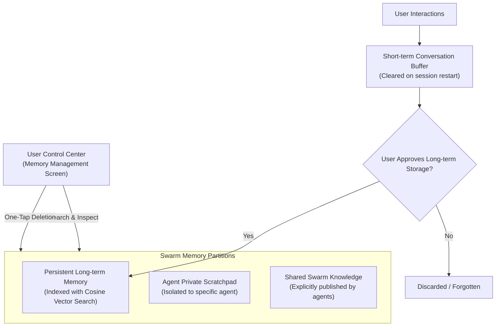

# SwarmDroid — Privacy & Data Governance

SwarmDroid is engineered to be privacy-first. In an era where AI assistants often silently scrape background data, SwarmDroid establishes strict boundaries on what information is recorded, where it is stored, and how users control their data.

---

## 1. Core Privacy Commitments

1. **Zero Silent Data Harvesting:** SwarmDroid never collects background audio, location, or private files without explicit, transparent user prompts.
2. **Local-First Memory Management:** Conversations and agent execution histories are stored on-device in an encrypted Room SQLite database (`swarmdroid.db`).
3. **Inspectable & Deletable Memory:** Users have full access via the **Memory Management** screen to inspect all recorded facts, short-term buffers, and shared agent knowledge, with one-tap permanent deletion.
4. **Minimum Device Privileges:** Official Android APIs are used with the principle of least privilege. Floating companion overlays (`SYSTEM_ALERT_WINDOW`) and speech recognition (`RECORD_AUDIO`) are strictly opt-in and runtime-requested.
5. **No Telemetry Leaks:** Tool executions, prompt payloads, and model logs are sanitized by `SecretRedactor` to strip API keys, Bearer tokens, and sensitive identifiers.

---

## 2. Memory Scopes & Governance

---

## 3. Human Approval for Sensitive Actions
Any action that can alter device state or communicate with the outside world requires an interactive confirmation:
- Sending an email (`CommunicationAgent`)
- Publishing an X or LinkedIn post (`SocialMediaAgent`)
- Adjusting system settings or launching apps (`DeviceAgent`)
- Deleting persistent memories (`MemoryAgent`)
