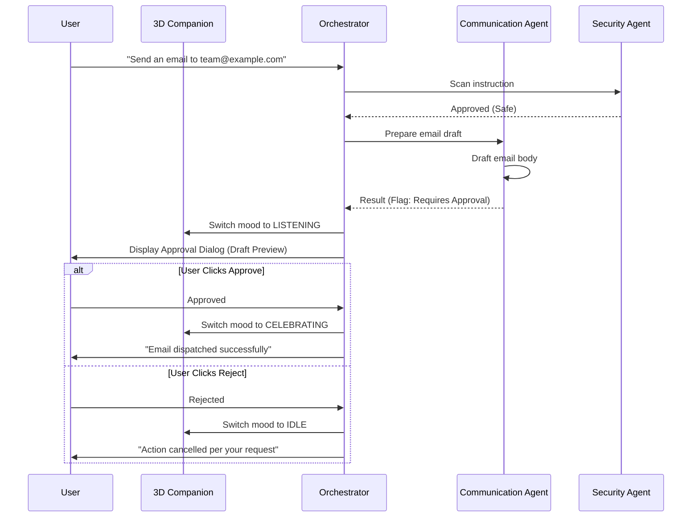

# SwarmDroid — Security Architecture & Threat Model

Security is a foundational design requirement for SwarmDroid. A mobile multi-agent ecosystem with access to device actions and generative models presents unique security considerations that must be actively defended against.

---

## 1. Threat Model & Mitigations

| Threat Vector | Potential Impact | SwarmDroid Defensive Mitigation |
|---|---|---|
| **Indirect Prompt Injection** | Untrusted web/document content hijacks agent goals | `SecurityAgent` & `PromptDefense` sanitize inputs, evaluate against injection heuristics, and isolate untrusted content into passive data channels. |
| **Privilege Escalation** | Dynamic agent requests unapproved device tools | `DynamicAgentManager` validates against strict tool allowlists; forbidden tools (`*`, `system_override`, `shell`) trigger immediate instantiation rejection. |
| **Unauthorized Sensitive Actions** | Agent sends email or publishes social post automatically | `PermissionScope` flags sensitive tools (`send_email`, `post_social_media`, `modify_device_settings`) into `WAITING_FOR_APPROVAL` requiring explicit user authorization. |
| **API Key Exfiltration** | Model output or logs leak user keys or tokens | `SecretRedactor` scans all logs, thoughts, and outputs with regex filters to scrub keys (`sk-...`, `AIzaSy...`, `Bearer ...`). |
| **On-Device Storage Compromise** | Malicious local app reads stored API keys | `SecurityManager` uses Android Keystore `MasterKey` with AES-256-GCM hardware-backed encryption. |
| **Network Interception (MITM)** | Eavesdropping on agent communications | Enforced TLS/WSS connections with strict certificate validation. |

---

## 2. Hardware-Backed Credential Storage

API keys for OpenAI, Google Gemini, Anthropic Claude, and OpenRouter are never stored in plaintext SharedPreferences or SQLite databases. 

SwarmDroid employs Android's `EncryptedSharedPreferences`:
```kotlin
val masterKey = MasterKey.Builder(context.applicationContext)
    .setKeyScheme(MasterKey.KeyScheme.AES256_GCM)
    .build()

val securePrefs = EncryptedSharedPreferences.create(
    context.applicationContext,
    "swarmdroid_secure_prefs",
    masterKey,
    EncryptedSharedPreferences.PrefKeyEncryptionScheme.AES256_SIV,
    EncryptedSharedPreferences.PrefValueEncryptionScheme.AES256_GCM
)
```

---

## 3. Sandboxing Dynamically Created Agents

Dynamic agents are constrained by:
1. **Explicit Tool Allowlists:** They can only access safe tools specified at creation time (`web_search`, `fetch_url`, `run_sandbox_code`).
2. **Code Execution AST Validation:** Python code executed via `CodeExecutionTool` is parsed using `ast.walk` to block dangerous imports (`os`, `subprocess`, `sys`, `socket`, `shutil`).
3. **Execution Timeouts:** Per-task execution timeout (default: 60s) and bounded concurrency prevent runaway tasks or infinite recursion loops.
4. **Isolated Memory Partitions:** Dynamic agents cannot access private memory buffers of other agents unless shared explicitly.

---

## 4. Human-in-the-Loop Approval Workflow



---

## 5. Security Audit Logging

All security-sensitive operations are recorded to the append-only `audit_logs` table in `SwarmDatabase`, tracking:
- Timestamp & unique entry ID
- Agent ID & role
- Action type (`PROMPT_EVAL`, `TOOL_EXEC`, `APPROVAL_REQ`, `APPROVAL_DECISION`, `SECURITY_ALERT`)
- Redacted parameter details
- Status (`SUCCESS`, `BLOCKED`, `PENDING_APPROVAL`, `REJECTED`)
